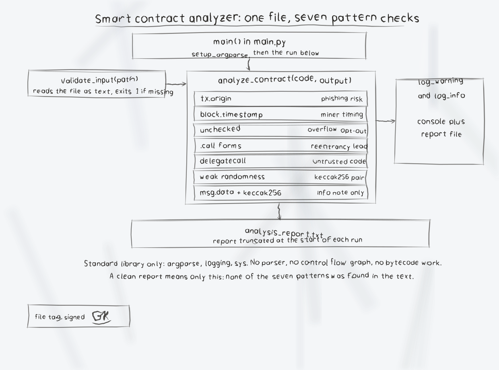

# crypto-smart-contract-static-analyzer

Title block: the first line of a fresh log page. The name above is entered in Bodoni Moda SC, chrome on coffee black, with the hour space left blank at the left and one small lantern plate beside this first heading only. The remaining headings keep the watch log form without the lantern.


# crypto-smart-contract-static-analyzer

A small pattern matching static analyzer for smart contract source files. It reads one contract file as text and reports a short list of known risky patterns. It does not build a control flow graph, parse Solidity, or prove that a contract is safe or exploitable.


## Checks performed

- `tx.origin` usage (phishing risk)
- `block.timestamp` usage (timestamp dependence)
- The literal word `unchecked` (arithmetic that opts out of Solidity 0.8 overflow checks)
- Low level external calls: `.call{`, `.call.value(`, `.call(` (a reentrancy relevant pattern if state is updated after the call)
- `delegatecall` usage
- Weak randomness pattern `keccak256(block.difficulty, block.timestamp)`
- Informational note when `msg.data` and `keccak256` both appear

> Watch note, entered in the margin hand: A listed phrase inside a comment stops the round exactly as the same phrase in live code does, and a listed phrase inside a string literal does the same. Matching is substring matching on raw text, and a clean report means the seven strings were absent, and nothing more.


## Requirements

- Python 3.10 or later
- No third party packages. The tool uses only the Python standard library, so `requirements.txt` is intentionally empty.


## Install

```bash
git clone https://github.com/ShadowGuard-AI/crypto-smart-contract-static-analyzer.git
cd crypto-smart-contract-static-analyzer
```


## Usage

```
python3 main.py [-h] [--output OUTPUT] [--verbose] contract_code
```

- `contract_code`: path to the contract source or text file to scan (required)
- `--output OUTPUT`, `-o OUTPUT`: report file. Default: `analysis_report.txt`. The file is overwritten at the start of each run. The output path must not be the contract file itself: if the resolved output path is the same file as the input, including a relative spelling of the same path or a symlink to it, the tool prints an error and exits 1 before writing anything, so the contract source is left unchanged.
- `--verbose`, `-v`: set logging to debug level
- `-h`: show help and exit

Findings are logged to the console and appended to the report file as `[WARNING]` or `[INFO]` lines during that run.

> Watch note, entered in the margin hand: The weak randomness check is exact in argument order and spacing: the same fault written with swapped arguments or an extra space passes unseen. This check is the strictest of the seven on exactly this point.

> Watch note, entered in the margin hand: A failure partway through a round leaves the partial report standing, each line having been opened, written, and closed on its own, and that failure exits 1.


## Examples

```bash
python3 main.py contract.sol
python3 main.py contract.sol --output analysis.txt
python3 main.py contract.sol -v
```

For a contract containing `tx.origin` and `block.timestamp`, the report contains:

```
[WARNING] Potential tx.origin usage detected. This can be vulnerable to phishing attacks.
[WARNING] Potential timestamp dependence detected. This can be manipulated by miners.
[INFO] Performing basic vulnerability checks...
[INFO] Analysis completed.
```

A missing input file prints `Error: File not found: <path>` and exits with status 1.


## Limitations

- Pure substring pattern matching on the file text. It does not understand Solidity syntax, bytecode, data flow, or whether state changes happen before or after an external call, so it cannot confirm true reentrancy or integer overflow.
- A clean report only means none of the listed patterns were found.


## License

Copyright (c) ShadowGuardAI

> Watch note, entered in the margin hand: the licence line above is shown as printed and is flagged in place. It names the organisation in an unhyphenated form, while the separate LICENSE file holds the MIT License. The two stand side by side, unreconciled, as they stand in the repo.


## Diagrams and maps

I drew the tool out in [crypto-smart-contract-static-analyzer-Visuals](crypto-smart-contract-static-analyzer-Visuals/): an architecture diagram, a data-flow diagram, a flowchart of a scan, and a product map, with the written product map, statistics with citations, and the roadmap in [VISUAL.md](crypto-smart-contract-static-analyzer-Visuals/VISUAL.md). Every sheet also ships as a PNG photograph of the paper page beside its SVG.




Log notes, entered plainly at the close. The report file is emptied at the start of each run, before findings are entered. A finished round exits 0, whether its report holds warnings or none. The story closes at the yard: the cart emptied of its round, the lantern set down still lit on the gatehouse step, the bell rope still, the cat gone from the crossbar, and the first grey over the wall arriving to find the work already done.
