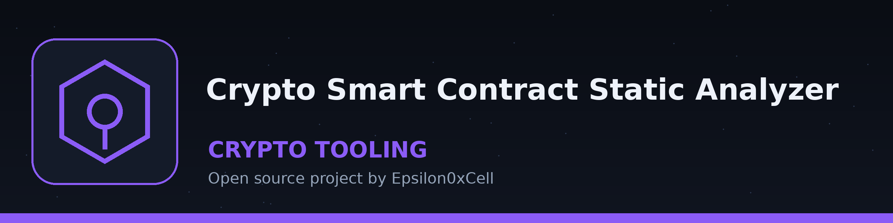
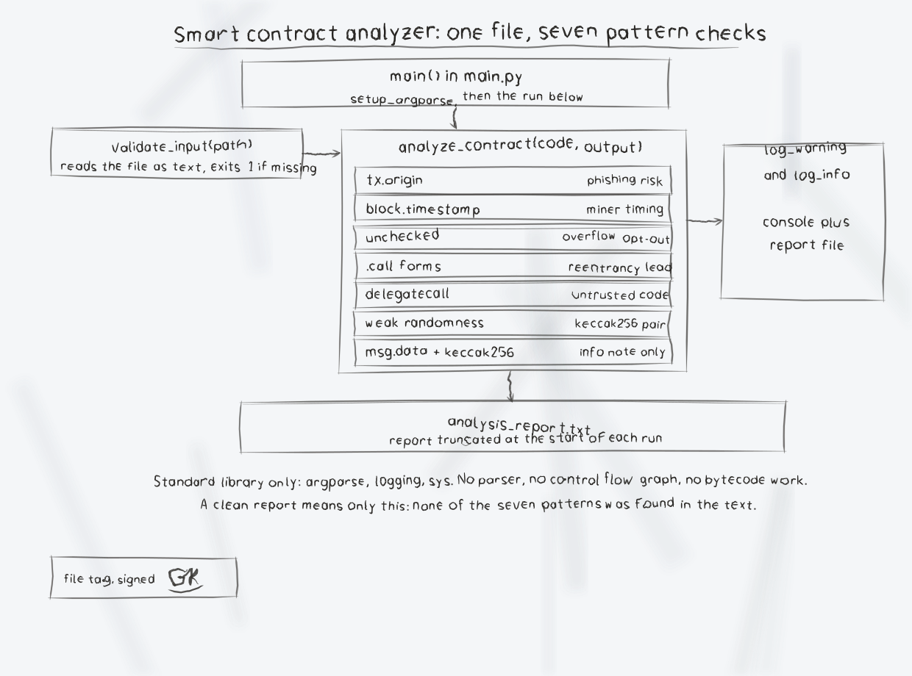

# crypto-smart-contract-static-analyzer

A small pattern matching static analyzer for smart contract source files. It reads one contract file as text and reports a short list of known risky patterns. It does not build a control flow graph, parse Solidity, or prove that a contract is safe or exploitable.

## Checks performed

- `tx.origin` usage (phishing risk)
- `block.timestamp` usage (timestamp dependence)
- The literal word `unchecked` (arithmetic that opts out of Solidity 0.8 overflow checks)
- Low level external calls: `.call{`, `.call.value(`, `.call(` (a reentrancy relevant pattern if state is updated after the call)
- `delegatecall` usage
- Weak randomness pattern `keccak256(block.difficulty, block.timestamp)`
- Informational note when `msg.data` and `keccak256` both appear

## Requirements

- Python 3.10 or later
- No third party packages. The tool uses only the Python standard library, so `requirements.txt` is intentionally empty.

## Install

```bash
git clone https://github.com/ShadowGuardAI/crypto-smart-contract-static-analyzer.git
cd crypto-smart-contract-static-analyzer
```

## Usage

```
python3 main.py [-h] [--output OUTPUT] [--verbose] contract_code
```

- `contract_code`: path to the contract source or text file to scan (required)
- `--output OUTPUT`, `-o OUTPUT`: report file. Default: `analysis_report.txt`. The file is overwritten at the start of each run. The output path must not be the contract file itself: if the resolved output path is the same file as the input, including a relative spelling of the same path or a symlink to it, the tool prints an error and exits 1 before writing anything, so the contract source is left unchanged.
- `--verbose`, `-v`: set logging to debug level
- `-h`: show help and exit

Findings are logged to the console and appended to the report file as `[WARNING]` or `[INFO]` lines during that run.

## Examples

```bash
python3 main.py contract.sol
python3 main.py contract.sol --output analysis.txt
python3 main.py contract.sol -v
```

For a contract containing `tx.origin` and `block.timestamp`, the report contains:

```
[WARNING] Potential tx.origin usage detected. This can be vulnerable to phishing attacks.
[WARNING] Potential timestamp dependence detected. This can be manipulated by miners.
[INFO] Performing basic vulnerability checks...
[INFO] Analysis completed.
```

A missing input file prints `Error: File not found: <path>` and exits with status 1.

## Limitations

- Pure substring pattern matching on the file text. It does not understand Solidity syntax, bytecode, data flow, or whether state changes happen before or after an external call, so it cannot confirm true reentrancy or integer overflow.
- A clean report only means none of the listed patterns were found.

## License

Copyright (c) ShadowGuardAI

## Diagrams and maps

I drew the tool out in [crypto-smart-contract-static-analyzer-Visuals](crypto-smart-contract-static-analyzer-Visuals/): an architecture diagram, a data-flow diagram, a flowchart of a scan, and a product map, with the written product map, statistics with citations, and the roadmap in [VISUAL.md](crypto-smart-contract-static-analyzer-Visuals/VISUAL.md). Every sheet also ships as a PNG photograph of the paper page beside its SVG.


